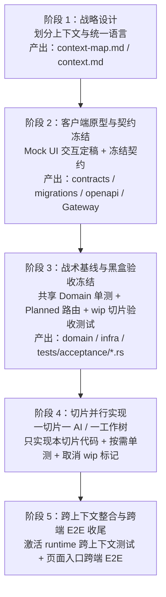

# AI 协同交付与全链路测试时机工作流

本文档沉淀多 Agent（架构 AI / 切片 AI / 集成 AI）协同研发的阶段边界、并发安全区间，以及各类测试的**责任归属、编写时机与冻结稳定性判定**。

---

## 1. 五阶段协同流水线与并行隔离边界



### 并发边界与冲突热点控制

| 阶段 | 负责角色 | 允许改动范围 | 并行安全度 | 说明 |
| :--- | :--- | :--- | :--- | :--- |
| **阶段 1–3** | 架构/主干 AI | `context*.md`、`migrations/`、`backend/{primitives,contracts,infra,api}`、`domain/`、`clients/{gateway,app}` 基础契约与 `tests/acceptance/*.rs` | **严格串行（主干冻结）** | 共享契约未冻结前严禁派发并行切片 AI，否则下游大面积返工。 |
| **阶段 4** | 垂直切片 AI | 单个 `<ctx>/features/src/<slice>/`（及对应 `endpoint.rs`、`acceptance/<slice>.rs`） | **100% 并行零冲突** | 阶段 3 冻结 `handler::execute` 空签名存根与 `gateway` 转发后，切片 AI 只填实自己目录内的实现，不再修改 `runtime` 或 `gateway`。 |
| **阶段 5** | 集成收尾 AI | `backend/runtime/tests/`、`clients/{cli,app}` 真实模式配置、`e2e/tests/` | **单点汇聚** | 全部切片合入后再接入真实客户端配置与跨端 E2E 闭环。 |

---

## 2. 全栈测试编写时机与“前置稳定性”判定矩阵

评估一项测试**能不能在切片代码尚未实现之前就稳定写出来**，第一性原理只有一个标准：**它依赖的契约（DTO、数据库表、UI 无障碍标签、或内部函数签名）是否已经冻结**。

| 测试类型 | 物理目录 | 谁来写 | 何时写 | 切片实现前能否写出稳定测试？ | 依赖前提与原因 |
| :--- | :--- | :--- | :--- | :--- | :--- |
| **1. 原语/共享领域单元测试** | `backend/primitives/src/tests/`<br>`backend/contexts/*/domain/src/tests/` | 架构/内核 AI | **阶段 3**（随共享内核冻结即写即绿） | **直接写且立即可跑通** | 纯函数与不变量先于切片冻结，是切片的基石。 |
| **2. 后端切片单元测试** | `contexts/*/features/src/<slice>/tests/` | **切片 AI** | **阶段 4**（按需编写） | **不能，严禁提前写** | 切片内部的 `command.rs` / `workflow.rs` / helper 签名属于切片内部重构自由度；只测值得测的纯规则计算。 |
| **3. 客户端切片单元测试** | `clients/app/src/features/<ctx>/<slice>/tests.rs` | 客户端设计 AI | **阶段 2**（随前端原型同步写出） | **直接写且立即可跑通** | 前端输入校验与命令组装只依赖 `contracts` DTO，不依赖后端是否实现。 |
| **4. 后端切片黑盒验收测试** | `contexts/*/features/tests/acceptance/<slice>.rs` | 架构/基线 AI | **阶段 3 写出（标 `#[ignore = "wip"]`），阶段 4 激活** | **能！非常稳定** | 仅通过 HTTP `oneshot` 测输入/输出 JSON、状态码、幂等与 DB 结果；跨上下文 Port 用 `Fake*Port` 隔绝，完全不碰切片内部代码。 |
| **5. API / Gateway 契约测试** | `backend/api/src/tests/`<br>`clients/gateway/src/tests/` | 架构/客户端 AI | **阶段 2–3** | **能（按 `Active` 数量渐进调整）** | 守卫 `OpenAPI` 结构、`Planned` 隐藏策略与 `MockGateway` 契约一致。 |
| **6. Page UI 验收测试** | `clients/app/src/pages/<page>/*.test.tsx` | 客户端设计 AI | **阶段 2**（随原型即写即绿） | **能！非常稳定** | 通过 `nsh/test` 无头运行，后端全部由 `MockGateway` 承接，不依赖后端切片实现。 |
| **7. CLI 本地子进程验收** | `clients/cli/tests/cli_acceptance/` | CLI/集成 AI | **阶段 2 写命令框架测试，阶段 5 接真实 DB** | **仅参数/退出码部分稳定；真 DB 需待切片激活** | 早期依赖 `MockGateway`；切到 `--local --db` 真实运行时后，必须依赖后端切片与合法主键/幂等键才能稳定通过。 |
| **8. `runtime` 跨上下文测试** | `backend/runtime/tests/` | 架构/集成 AI | **阶段 3 可先留 `#[ignore = "wip"]` 场景契约，阶段 5 激活** | **行为可预写，断言依赖全部关联切片激活** | 直接通过 `AppState` 调用跨上下文 `handler::execute` 与 `dispatch_outbox`（不经 HTTP），需相关上下文全部切片激活后转绿。 |
| **9. 页面入口跨端 E2E 测试** | `e2e/tests/` | 集成 AI | **阶段 5**（切片与 `RemoteGateway` 全部就绪后） | **不建议过早写死细节，应在阶段 5 落地** | 驱动真实 Page (`nsh_testing::Headless`) → `RemoteGateway` → 真实 API Server → SQLite。过早编写容易受真实登录方式、真实学号生成规则与 UI 表单默认值漂移影响而返工。 |

---

## 3. 从本次交付中提炼的工作流优化建议（减少摩擦）

### 建议 1：保持 `runtime` 为纯组合根，并在阶段 3 冻结 `handler::execute` 存根

- **核心原则**：`Local` 只是客户端本地部署形态（服务 CLI / 离线 TUI，且纯本地项目严禁引入 Axum），与后端垂直切片无关。
- **零冲突落地规范**：
  1. 在 **阶段 3** 连同 `endpoint.rs`（`Planned`）一起，把每个切片的 `handler::execute(&AppState, &OperatorPrincipal, ReqDTO) -> Result<RespDTO, ProblemDetails>` 空签名存根一并落盘冻结；同时 `clients/gateway/src/{local,remote}/` 在阶段 2–3 一次性写完转发代码（不再保留 `planned_err` 客户端占位）。
  2. `backend/runtime` 仅作为组合根（`bootstrap.rs` 装配 `AppState` + 汇总导出上下文模块），严禁额外编写逐切片透传的 `executor.rs`。阶段 4 多 Worktree 并行实现时，每个切片 AI **100% 只改自己切片目录与验收测试**。

### 建议 2：网络与运行时模式纯配置化，杜绝渲染线程状态撕裂

- **痛点**：客户端最初使用 `thread_local! ACTIVE_GATEWAY`，在 `nsh-engine` 独立 UI 线程上失效；切换 `Mock` / `Local` / `Remote` 时缺乏统一配置结构体。
- **改进方向**：在组合根定义显式启动配置：

  ```rust
  pub enum GatewayMode {
      MockSeeded,
      Remote { base_url: String },
  }
  ```

  在阶段 2 客户端设计之初就将该配置对象接入跨线程共享入口（`RwLock` 或引擎环境注入），让页面在 `pages/*.test.tsx` 跑 `MockSeeded`、在 `e2e/` 跑 `Remote { base_url }`、在桌面发布跑 `SMS_SERVER / --server` **完全复用同一套启动逻辑，无需任何代码改动**。

### 建议 3：尽早在阶段 2 对齐测试数据前置条件与真实后端约束

- **痛点**：阶段 2 客户端 `MockGateway` 预设 `"20261001"` 与演示快速角色按钮，而真实后端 `cmd_enroll_student` 首号生成 `"20260001"`、且 `RemoteGateway` 禁用 `switch_role` 需真实账号密码认证，导致阶段 5 E2E 联调时需要额外对齐默认值或清框重填。
- **改进方向**：在阶段 2 客户端设计审查时即明确两条约束：
  1. 跨端联调路径上的所有演示表单不得把 Mock 专用主键硬编码为不可清除状态，且 `login_page` 真实表单的默认账密、错误提示须可直接驱动 `/api/v1/auth/sign-in`。
  2. 客户端生成幂等键必须通过统一的“去空白 + 截断”工具函数构造，确保对接真实 `IdempotencyKey` 原语校验零失败。

### 建议 4：严格区分 `#[sqlx::test]` 与 `#[rstest]`、避免内存池死锁

- **写测试边界律令**：需要 `#[rstest]` 参数化矩阵的切片验收测试，统一用 `#[tokio::test]` + `open_sqlite_pool("sqlite::memory:")`，避免与 `#[sqlx::test]` 宏属性发生冲突；所有在事务外调用 `Port` 的约定必须在阶段 3 `acceptance` 阶段即以 `:memory:`（单连接）跑实，第一时间暴露任何事务内调 `Port` 的潜在死锁。
