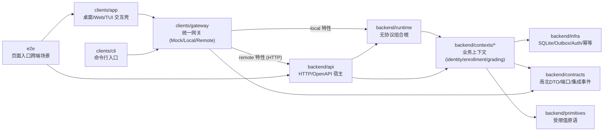

# 架构边界、规则与完整文件树规范

本文档定义学生管理系统（Modular Monolith + Vertical Slice Architecture + CQRS + DMMF）的物理文件树、各层级唯一职责与边界不变量。

---

## 1. 第一性原理与全局依赖方向

系统的所有依赖必须严格遵循“单向收敛、中心冻结、边缘自注册、协议与业务解耦”四项不变量：



---

## 2. 完整仓库文件树与职责边界

### 2.1 根配置、契约产物、迁移与防线目录

```text
student-management/
├── AGENTS.md                         # 仓库级 AI 开发规则入口（指向 CONTRIBUTING.md）
├── CONTRIBUTING.md                   # 本地环境、mise/hk 检查命令与 PR/提交规范
├── Cargo.toml                        # 工作区成员清单与全局 Rust/Clippy 强约束 lints
├── clippy.toml                       # 禁用危险方法/类型（std::sync::Mutex/var/sleep/SystemTime）
├── deny.toml                         # cargo-deny 许可证白名单、安全公告与多版本审计
├── mise.toml                         # 唯一命令执行网关（fmt/check/client/e2e/lock/openapi/api/sms/app/web）
├── sgconfig.yml                      # ast-grep 静态架构检查配置入口
├── context-map.md                    # 全局限界上下文地图与上游/下游集成契约总览
├── contracts/
│   └── openapi.json                  # [生成产物] 由 backend/api 导出的 OpenAPI 3.1 SSOT
├── migrations/                       # 全局单调递增 SQLite DDL（唯一表结构真源）
│   ├── 0001_init_identity.sql        # accounts / sessions 表
│   ├── 0002_init_enrollment.sql      # homerooms / students / enrollment_change_records / student_seq
│   ├── 0003_init_grading.sql         # courses / teaching_assignments / grade_entries / grade_amendments
│   └── 0004_init_infra_outbox_idempotency.sql # idempotency_records / outbox_events
├── docs/
│   ├── development_rules.md          # 注释禁令：通过命名与受限类型表达意图
│   ├── architecture-rules.md         # [本文档] 完整文件树、边界与禁用清单
│   ├── ai-delivery-workflow.md       # AI 分阶段协同与测试编写时机工作流
│   └── adr/
│       ├── 0001-immutable-student-number-and-terminal-status.md
│       └── 0002-sqlite-wal-and-runtime-api-split.md
└── rules/                            # ast-grep 架构边界静态规则（18 条）
    ├── no-client-import-backend-internals.yml
    ├── no-client-import-runtime-outside-local.yml
    ├── no-client-layer-or-slice-cross-imports.yml
    ├── no-client-pages-import-app.yml
    ├── no-cross-slice-imports.yml
    ├── no-domain-in-query.yml
    ├── no-effect-outside-ui.yml
    ├── no-gateway-in-client-view.yml
    ├── no-global-state-in-pages.yml
    ├── no-http-in-infra-and-runtime.yml
    ├── no-imperative-timers-outside-ui.yml
    ├── no-inline-tests.yml
    ├── no-io-in-workflow.yml
    ├── no-line-comments.yml
    ├── no-local-state-root-in-features.yml
    ├── no-nsh-base-outside-ui.yml
    ├── no-raw-style-outside-ui.yml
    └── no-view-in-client-command.yml
```

- **根配置与契约区规则**
  - `Cargo.toml` / `clippy.toml` / `rules/` 是架构防线的最终裁决者：**严禁**切片开发者通过 `#[allow(...)]` 绕过 lint（工作区已配置 `allow_attributes = "forbid"`）；存在合理局部例外必须使用带 `reason` 的 `#[expect(...)]`。
  - `migrations/` 只允许向后追加新迁移脚本，**严禁**修改已提交的旧 `.sql` 文件；且**严禁**在上下文表之间声明跨上下文 SQLite 外键（仅保留同上下文内表外键，跨上下文只存标识并经 `contracts/ports` 校验）。
  - `contracts/openapi.json` 只允许通过 `mise run openapi` 生成，**严禁**手改。

---

### 2.2 后端共享内核与宿主目录（`backend/` 基础层）

```text
backend/
├── primitives/                       # [Crate] 全局受限业务原语（零外部业务依赖）
│   ├── Cargo.toml
│   └── src/
│       ├── lib.rs                    # 纯声明导出入口
│       ├── error.rs                  # PrimitiveError 校验失败枚举
│       ├── common.rs                 # NonEmptyText / ReasonText / IdempotencyKey / PositiveVersion
│       ├── identity.rs               # Username
│       ├── enrollment.rs             # StudentNo / HomeroomName / GradeYear
│       ├── grading.rs                # CourseCode / TermCode / Score / MaxScore
│       ├── tests.rs                  # 单元测试声明容器
│       └── tests/
│           ├── enrollment.rs
│           ├── grading.rs
│           └── identity.rs
├── contracts/                        # [Crate] 南北向 DTO、错因协议与东西向 Port/Event 契约
│   ├── Cargo.toml                    # openapi 特性可选开启 utoipa::ToSchema
│   └── src/
│       ├── lib.rs                    # 纯导出入口
│       ├── types.rs                  # 开放枚举 Role / AccountStatus / EnrollmentStatus / GradeStatus
│       ├── error.rs                  # 封闭 PortError 与标准 RFC 9457 ProblemDetails
│       ├── protocol.rs               # 全部请求/响应 DTO（AccountSession/StudentSummary/...）
│       ├── ports.rs                  # OperatorPrincipal / IdentityLookupPort / EnrollmentQueryPort
│       ├── events.rs                 # #[non_exhaustive] IntegrationEvent（StudentWithdrawn）
│       ├── clock.rs                  # Clock 抽象特征
│       └── ids.rs                    # IdGenerator 抽象特征
├── infra/                            # [Crate] 技术基础设施（默认无 HTTP 依赖）
│   ├── Cargo.toml                    # Axum/utoipa 严格隔离在 optional http feature 下
│   └── src/
│       ├── lib.rs
│       ├── db.rs                     # SQLite WAL 连接池与 MIGRATOR（:memory: 限单连接）
│       ├── state.rs                  # AppState（pool + clock + ids + 可选跨上下文 Ports）
│       ├── auth.rs                   # authenticate_bearer / ensure_role / parse_role / 错误映射
│       ├── password.rs               # Argon2 密码哈希与校验
│       ├── idempotency.rs            # check_idempotency / save_idempotency
│       ├── outbox.rs                 # inventory::collect!(OutboxSubscription) / enqueue_event / dispatch_pending
│       ├── registry.rs               # [cfg(feature = "http")] SliceDescriptor / build_context_router
│       ├── clock.rs                  # FixedClock / SystemClock
│       ├── ids.rs                    # SequentialIdGenerator / UuidGenerator
│       ├── error.rs                  # InfraError
│       ├── tests.rs
│       └── tests/{auth,idempotency,outbox,password}.rs
├── runtime/                          # [Crate] 无协议组合根（仅负责 AppState 装配、Outbox 与模块导出）
│   ├── Cargo.toml
│   ├── clippy.toml
│   ├── src/
│   │   ├── lib.rs                    # 导出 bootstrap 辅助与 identity / enrollment / grading 上下文
│   │   └── bootstrap.rs              # link_all_contexts / build_app_state / ensure_bootstrap_admin / dispatch_outbox
│   └── tests/
│       ├── cross_context.rs          # runtime 跨上下文测试聚合入口
│       └── cross_context/journeys.rs # 跨上下文 Outbox 联动与 Port 拒绝测试（不走 HTTP）
└── api/                              # [Crate] Axum HTTP 服务与 OpenAPI 导出宿主
    ├── Cargo.toml
    ├── clippy.toml
    └── src/
        ├── lib.rs
        ├── main.rs                   # --export-openapi 与 127.0.0.1:8080 HTTP 监听启动
        ├── router.rs                 # /health + 收集全部 Active SliceDescriptor 路由
        ├── openapi.rs                # utoipa OpenApi 聚合声明
        ├── tests.rs
        └── tests/
            ├── openapi.rs            # 校验导出文档与 contracts/openapi.json 一致
            └── router.rs             # 校验 27 个切片全部注册与激活状态
```

- **`primitives/` 与 `contracts/` 规则**
  - **必须**：`primitives` 中的每个字段均为私有，只通过 `try_new` 构造（Parse, Don't Validate）。
  - **严禁**：`primitives` 与 `contracts` **严禁**引入数据库、HTTP 框架（`utoipa` 仅能作为可选 `openapi` derive 开关）或任何业务逻辑实现。
- **`infra/` 与 `runtime/` 规则**
  - **严禁**：在无 `http` 特性下引入 `axum`、`tower`、`utoipa`（`rules/no-http-in-infra-and-runtime.yml` 强制拦截）。
  - **严禁**：在 `runtime` 内维护逐切片透传的中心方法包装层（`handler::execute` 本身已是无协议应用层边界；`runtime` 只负责 `AppState` 装配、全局引导与模块汇总导出）。
  - **必须**：`backend/runtime/tests/` 只测多上下文协同（直调切片 `handler::execute` + `dispatch_outbox`），**严禁**在单上下文内重复测试单切片参数校验。
- **`backend/api/` 规则**
  - **必须**：路由通过 `inventory` 自动汇聚，**严禁**手写大段业务分发逻辑。

---

### 2.3 后端限界上下文目录（`backend/contexts/<ctx>/`）

三个上下文（`identity`、`enrollment`、`grading`）采用同构的 `domain` + `features` 双 Crate 布局：

```text
backend/contexts/
├── identity/
│   ├── context.md                    # 身份上下文战略边界与术语
│   ├── domain/
│   │   ├── Cargo.toml                # 纯 Rust，零 I/O
│   │   └── src/
│   │       ├── lib.rs / error.rs     # 封闭 DomainError
│   │       ├── account.rs            # Account 聚合、角色变更清空绑定、禁用防自锁
│   │       ├── tests.rs
│   │       └── tests/account.rs      # 纯领域单测
│   └── features/
│       ├── Cargo.toml                # default 无 HTTP，[features] http 启用 endpoint
│       ├── src/
│       │   ├── lib.rs                # 导出切片模块与空 link() 防链接器裁剪
│       │   ├── port.rs               # SqliteIdentityLookupPort 实现
│       │   ├── qry_accounts.rs / qry_accounts/{handler,endpoint}.rs
│       │   ├── cmd_sign_in.rs / cmd_sign_in/{command,handler,endpoint}.rs
│       │   ├── cmd_provision_account.rs / .../{command,workflow,handler,endpoint}.rs
│       │   ├── cmd_bind_person_profile.rs / ...
│       │   ├── cmd_change_account_role.rs / ...
│       │   └── cmd_disable_account.rs / ...
│       └── tests/
│           ├── acceptance.rs         # 黑盒验收测试聚合根
│           └── acceptance/
│               ├── support.rs        # build_context_router("identity") 测试夹具
│               ├── cmd_sign_in.rs
│               ├── cmd_provision_account.rs
│               ├── cmd_bind_person_profile.rs
│               ├── cmd_change_account_role.rs
│               └── cmd_disable_account.rs
├── enrollment/
│   ├── context.md
│   ├── domain/
│   │   └── src/
│   │       ├── lib.rs / error.rs / homeroom.rs / student.rs
│   │       └── tests/{homeroom,student}.rs
│   └── features/
│       ├── src/
│       │   ├── lib.rs / port.rs      # SqliteEnrollmentQueryPort 实现
│       │   ├── student_repo.rs       # 本上下文共享行映射与状态持久化（非切片前缀，允许复用）
│       │   ├── qry_homerooms / qry_students / qry_student_detail
│       │   └── cmd_create_homeroom / cmd_update_homeroom_capacity / cmd_enroll_student
│       │       / cmd_transfer_homeroom / cmd_suspend_student / cmd_resume_student
│       │       / cmd_withdraw_student / cmd_graduate_student / cmd_reverse_enrollment
│       └── tests/
│           ├── acceptance.rs
│           └── acceptance/
│               ├── support.rs        # build_context_router("enrollment") 测试夹具
│               ├── cmd_homeroom.rs / cmd_enroll_student.rs / qry_student_detail.rs
│               └── cmd_transfer_homeroom.rs / cmd_transition_student.rs / cmd_reverse_enrollment.rs
└── grading/
    ├── context.md
    ├── domain/
    │   └── src/
    │       ├── lib.rs / error.rs / course.rs / grade.rs
    │       └── tests/{course,grade}.rs
    └── features/
        ├── src/
        │   ├── lib.rs
        │   ├── grading_repo.rs       # 成绩视图与端口错误映射公共 helper
        │   ├── qry_courses / qry_teachings / qry_grades / qry_grade_amendments
        │   ├── cmd_create_course / cmd_assign_teaching / cmd_save_draft_grade
        │   │   / cmd_publish_grades / cmd_amend_grade
        │   └── evt_void_draft_grades.rs # Outbox 事件订阅切片（无 HTTP endpoint）
        └── tests/
            ├── acceptance.rs
            └── acceptance/
                ├── support.rs        # FakeIdentityPort + FakeEnrollmentPort 隔离夹具
                ├── cmd_create_course.rs / cmd_assign_teaching.rs / cmd_save_draft_grade.rs
                └── cmd_amend_grade.rs / evt_void_draft_grades.rs
```

- **上下文与切片内部铁律**
  - **严禁跨上下文直连**：`identity`、`enrollment`、`grading` 三者之间**严禁**互相导入 `domain` 或 `features`，**严禁**跨上下文 JOIN 数据库表；必须仅通过 `contracts/ports` 同步接口或 `IntegrationEvent` Outbox 通信。
  - **严禁同上下文跨切片互引**：同一 `features` Crate 内，任何 `cmd_*`、`qry_*`、`evt_*` **严禁**相互 `use`（`rules/no-cross-slice-imports.yml` 强制拦截）。可复用的本上下文行映射与仓储辅助函数，放在无切片前缀的 `<entity>_repo.rs`（如 `student_repo.rs`、`grading_repo.rs`）。
  - **严禁在读切片引入写侧领域模型**：`qry_*` 目录**严禁**导入 `<ctx>_domain`（`rules/no-domain-in-query.yml`）。
  - **严禁在 `workflow.rs` 执行 I/O**：`workflow.rs` 只做纯内存转换与领域调用（`rules/no-io-in-workflow.yml`）。
  - **严禁在持有 SQLite 事务期间调用跨上下文 Port**：因为内存数据库测试连接池（`:memory:`）`max_connections = 1`，持有 `pool.begin()` 时调用查询端口会立即死锁；所有 `state.enrollment_query` / `state.identity_lookup` 校验必须在 `begin()` 之前完成。
  - **严禁使用 `mod.rs` 与内联测试**：所有叶测试放在 `src/tests/<name>.rs` 或 `tests/acceptance/<slice>.rs`（`mod_module_files = "forbid"`、`rules/no-inline-tests.yml`）。

---

### 2.4 客户端与跨端端到端测试目录（`clients/` 与 `e2e/`）

```text
clients/
├── gateway/                          # [Crate] 客户端统一异步网关（mock / local / remote / nsh 四种特性）
│   ├── Cargo.toml                    # ureq 仅限 remote（非 wasm32），nsh-core 仅限 nsh 特性
│   └── src/
│       ├── lib.rs
│       ├── contract.rs / contract/{error,gateway}.rs  # 统一异步 Gateway 特征、GatewayClient 与 GatewayError
│       ├── mock.rs / mock/{store,seed,account,homeroom,grading}.rs
│       ├── local.rs / local/runtime.rs                # LocalGatewayHandle（仅 local 特性可用）
│       ├── remote.rs / remote/{client,transport}.rs   # GenericRemoteGateway<T>（RemoteGateway + NshRemoteGateway）
│       └── tests.rs / tests/{local_gateway,mock_gateway,mock_contracts}.rs
├── cli/                              # [Crate] 命令行客户端（--local 嵌入式 / --server 远端）
│   ├── Cargo.toml                    # features = ["local", "remote"] + tokio 单线程运行时
│   └── src/
│       ├── main.rs / cli.rs / runner.rs               # 全局开关、--db/--server/--token 路由
│       └── commands.rs / commands/{shared,auth,account,homeroom,student,grading}.rs
│   └── tests/cli_acceptance/
│       ├── main.rs
│       └── local_workflows.rs        # sms --local --db 子进程真实 SQLite 与退出码验收
└── app/                              # [Crate] NSH 跨端界面客户端（Desktop / Web / Mobile / TUI）
    ├── Cargo.toml                    # 启用 nsh + mock 特性（全端统一走 nsh_core::fetch，无 ureq 依赖）
    ├── DESIGN.md / theme.json / tsconfig.json
    └── src/
        ├── lib.rs / main.rs          # 导出 App 与 RemoteEndpoint 注入类型
        ├── gateway.rs                # 基于 nsh_core::prelude::global 的每实例 GatewaySlot
        ├── app/
        │   ├── init.rs               # EngineContext / SMS_SERVER / --server 网关解析与窗口配置
        │   ├── nav.rs                # 强类型路由与导航栈
        │   └── shell.rs              # 响应式多端导航外壳（在已登录 Owner 作用域触发拉取）
        ├── ui/                       # 纯设计系统控件（唯一允许接触 nsh_base/原始样式/定时器）
        │   ├── token.rs / platform.rs / motion.rs / navigation.rs
        │   ├── badge.rs / button.rs / dialog.rs / input.rs / select.rs / surface.rs / table.rs / tabs.rs / toast.rs / typography.rs
        │   └── tests.rs / tests/theme_guard.rs
        ├── features/                 # 客户端业务垂直切片（按上下文与功能组织）
        │   ├── identity/   {store.rs, parts.rs, cmd_provision/, cmd_disable/}
        │   ├── enrollment/ {store.rs, parts.rs, tests/filter.rs, cmd_enroll/, cmd_homeroom/, cmd_transition/}
        │   └── grading/    {store.rs, cmd_draft/, cmd_amend/}
        │       └── 每切片内部严格拆为：command.rs / handler.rs / view.rs / tests.rs
        └── pages/                    # 屏幕编排层与 Page 验收测试（tsx，使用 MockGateway）
            ├── login_page/           {page.rs, login_page.test.tsx}
            ├── students_page/        {page.rs, students_page.test.tsx}
            ├── student_detail_page/  {page.rs, student_detail_page.test.tsx}
            ├── homerooms_page/       {page.rs, homerooms_page.test.tsx}
            ├── grading_page/         {page.rs, grading_page.test.tsx}
            ├── accounts_page/        {page.rs, accounts_page.test.tsx}
            └── profile_page/         {page.rs}

e2e/                                  # [Crate] 跨端端到端测试（真实 Page 入口 → HTTP → SQLite）
├── Cargo.toml                        # 禁止直接充当 Mock 测试替身；每个场景独立 [[test]] 目标
├── src/lib.rs                        # 空占位库
└── tests/
    ├── fixtures/server.rs            # 启动绑定随机端口的真实 Axum API Server
    ├── login_and_enroll_student_e2e.rs
    ├── grading_publish_and_amend_e2e.rs
    └── scenarios/
        ├── login_and_enroll_student.rs
        └── grading_publish_and_amend.rs
```

- **客户端边界铁律**
  - **严禁客户端直触后端内部实现**：`clients/app`、`clients/cli` **严禁**导入 `backend/infra`、`backend/runtime` 或 `contexts/*`（`rules/no-client-import-backend-internals.yml`、`rules/no-client-import-runtime-outside-local.yml`）。仅 `clients/gateway` 在启用 `local` 特性时可连接 `backend/runtime`。
  - **客户端切片内分层约束**：`view.rs` **严禁**直调 `gateway`；`command.rs` **严禁**引入 UI 视图；切片之间**严禁**跨切片互引（仅共享本功能组 `store.rs` 和 `parts.rs`）；业务 `features` 和 `pages` **严禁**直接使用 `nsh_base`、原始像素样式、副作用与裸定时器（全部收口至 `ui/`）。
  - **`pages/` 规则**：只做 `app` 壳传入回调后的屏幕拼装与导航，**严禁**直接访问全局状态根或依赖 `app/` 模块。

---

## 3. 关键架构不变量与并发零冲突基线

1. **`runtime` 作为纯组合根**
   - `backend/runtime` 仅保留 [bootstrap.rs](../backend/runtime/src/bootstrap.rs) 与上下文模块聚合导出；`endpoint.rs`（HTTP）与 `clients/gateway/src/local/`（本地直调）平级调用同一份 `slice::handler::execute`，严禁增加逐切片透传包装层。
   - 新增垂直切片时，在阶段 3 必须同步冻结 `handler::execute` 空签名、`endpoint.rs`（`Planned`）以及 `clients/gateway` 转发签名；阶段 4 并行实现期间严禁修改 `runtime` 或 `gateway`。

2. **客户端异步 `Gateway` 与实例级配置注入**
   - `Gateway` 仅暴露纯异步业务方法；`MockGateway` 的桩开关与角色辅助方法严格收敛在 `clients/gateway/src/mock/`，禁止向公共契约或生产页面泄露演示数据与伪操作。
   - `clients/app` 通过 `nsh_core::prelude::global` 保存每实例 `GatewayClient`，远端地址优先经 `EngineConfig::context`（`RemoteEndpoint`）注入，实现多引擎实例、WebAssembly 与跨端 E2E 并发安全。

3. **SQLite 事务与幂等键约束**
   - `clients/cli` 构造幂等键必须统一经过空白转义与长度截断，以满足 `IdempotencyKey` 原语校验。
   - 跨上下文 `Port` 必须在事务外调用，严格遵循“前置外部 Port 校验 → 开启事务 → 领域计算 → 落库与 Outbox/幂等写入 → 提交 → 本地事件分发”，防止 `:memory:` 单连接死锁。
